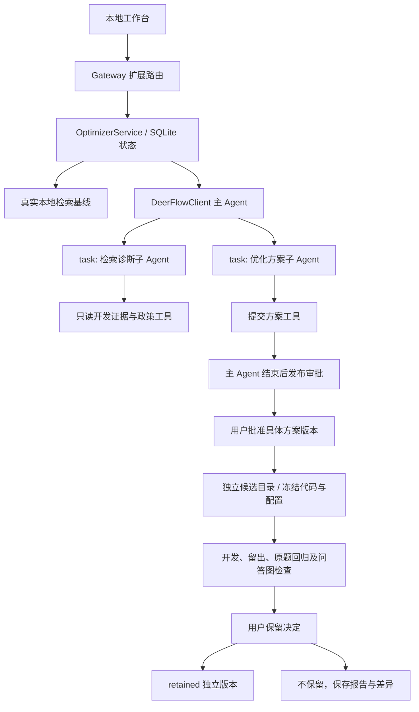

# 实际架构与代码入口

项目：rag-optimization-agent。固定上游提交：1dd6d056278536af1cb4fc60347f4ca40fcb629b。

## 代码职责

| 文件 | 关键入口 | 职责 |
|---|---|---|
| scripts/start.ps1、stop.ps1 | 启停脚本 | 隐藏启动、验证端口和进程身份，只管理本项目进程 |
| optimizer/launch.py | prepare_environment | 运行目录、本地单用户配置、密钥由应用加载、日志脱敏、关闭云端跟踪 |
| optimizer/extension.py | install | 通过官方扩展接口注册路由、服务与预算中间件 |
| optimizer/routes.py | build_router | 创建任务、查进度、审批、取消、保留；审批不是模型工具 |
| optimizer/service.py | create、_baseline、diagnose_deerflow、execute、retain | 从诊断到实验结果的业务状态协调 |
| optimizer/agent.py | run_diagnosis | 调用真实 DeerFlowClient.stream，启用原生 task 子任务并记录轨迹 |
| optimizer/tools.py | inspect_retrieval_task、read_policy_sources、propose_retrieval_plan | 有界只读工具和方案提交；工具只能访问当前绑定任务 |
| optimizer/middleware.py | BudgetContributor、BudgetAuditMiddleware | 主子 Agent 的物理模型调用预留、统计和限制 |
| optimizer/store.py | Store.propose、approve、claim_execution、reserve | SQLite 事务状态、方案 hash、重复执行阻断、预算记账 |
| optimizer/isolation.py | confined_path、snapshot_hash | 相对路径约束、符号链接/目录联接检查、源快照指纹 |
| optimizer/artifacts.py | freeze_adapter、candidate_hash、record_diff | 冻结自包含适配器，绑定代码、配置和索引，保存完整差异 |
| optimizer/retrieval.py | build_chunks、evaluate | 原始证据范围、切分、固定配置和评测报告 |
| optimizer/retrieval_worker.py | main | 在独立检索解释器运行本地模型；候选评测加载候选真实文件 |
| optimizer/rag_adapter.py | load_resources、rank_chunks | 生成候选的固定适配器来源；保留原 RAG 的函数接口 |
| optimizer/evaluation.py | score_case、aggregate、case_regressions | 区间并集、证据组召回、精确率、MRR、逐题退化 |
| optimizer/ui.html | 页面渲染及 API 请求 | 状态、证据、方案、对照与逐题退化展示 |

主子 Agent 的执行器、LangGraph 运行机制和 Gateway 来自 DeerFlow；本项目没有把普通评测程序冒充子 Agent。代码修改由服务端固定生成器在审批后执行，第一版不让模型任意运行 Shell 或自由改任意文件。

## 关键状态

正常路径：created → diagnosing → proposal_ready → awaiting_approval → approved → executing → verifying → awaiting_retention → retained/rejected。

proposal_ready 仍不允许用户批准；它防止子 Agent 已提交提案、主 Agent 尚未结束时发生竞态。审批同时绑定方案版本和源快照。中断、失败和取消单独记录；重新启动不自动重放丢失的执行队列。

## 原 RAG 如何保留

原目录仍在 C 盘，没有迁移、覆盖或推送修改。baseline/rag 保存其已提交源码快照。审批后创建 experiments/<task-id>/candidate，里面有独立 chunks.json、retrieval_config.json、vector_index.pt、检索入口和冻结的 candidate_retrieval 包。

实际问答图仍沿用原 RAG 的路由、证据检查、补检、回答与引用校验，候选只替换检索实现和有限候选数量。评测分别记录初始候选、排序后候选、预算过滤后上下文、潜在补检窗口；潜在窗口不冒充每题真实触发的补检。

保留也只复制到 retained，不自动合入原目录。候选的代码与索引必须与实际评测产物匹配；原回归逐题退化不能被平均分抵消。
